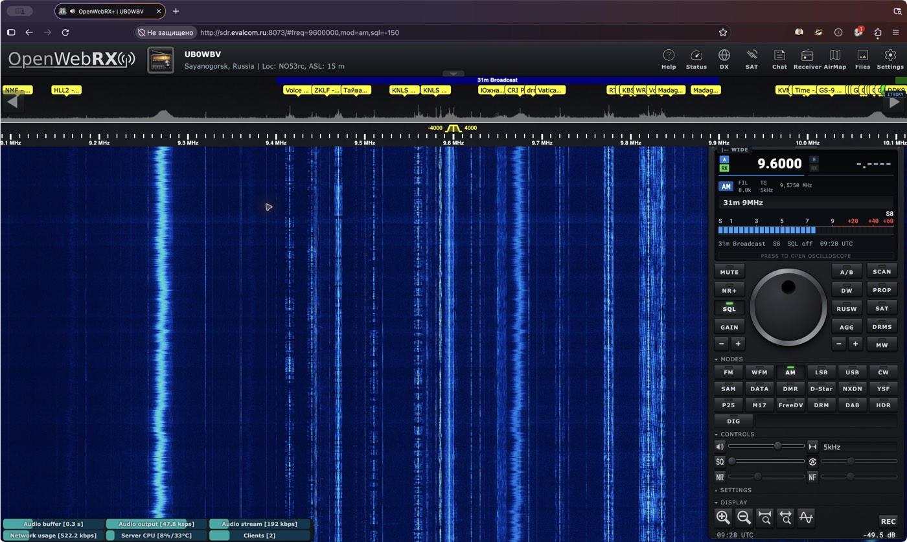
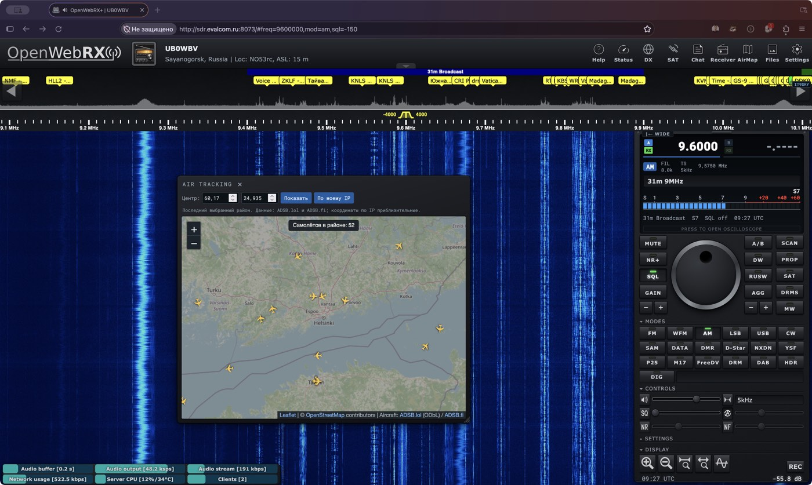
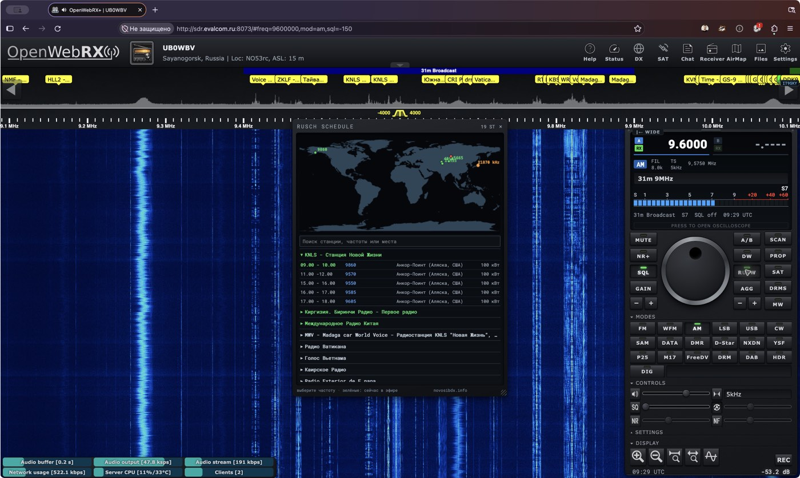
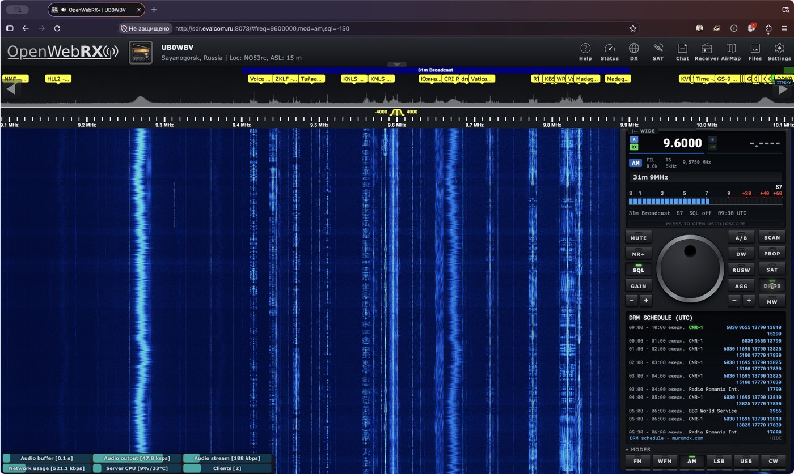
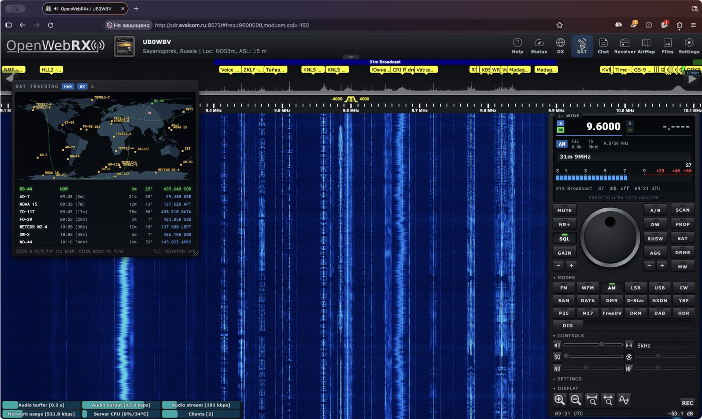

# OpenWebRX+ — доработки приёмника

Набор изменений для OpenWebRX+ 1.2.127: серверный код и интерфейс, сохранённые в виде файлов для установки поверх соответствующей версии. Это не самостоятельный дистрибутив. Перед применением сравните файлы со своей установкой и сделайте резервную копию: замена файлов другой версии может нарушить работу.

## Что изменено

- Панель приёмника в стиле RIG: собственная компоновка, оформление элементов, стабильные размеры при раскрытии секций, а также настройка управления и визуальных индикаторов.
- RUSW: окно расписаний радиовещания; DRMS: расписание цифрового вещания; интеграция данных NovosibDX.
- Звуковой тракт: настройки широкополосного FM, обработки и шумоподавления, интеграция фильтра audio_filter и управления NF; серверные изменения DSP и соединения.
- AirMap в верхнем меню: карта самолётов с объединением данных ADSB.lol и ADSB.fi, удалением повторов, резервированием источников и приблизительным центром по IP пользователя.
- Аватар приёмника (assets/receiver_avatar.png), оформление окна чата, ссылки на авторов, настройки и запуск интерфейса.
- Файлы организации резервных копий: пример скрипта для NAS. Настройку доступа и адрес NAS необходимо задать отдельно.

## Происхождение и лицензии

- [OpenWebRX+ Марата Файзуллина](https://github.com/luarvique/openwebrx) основан на OpenWebRX; исходный проект распространяется по AGPL-3.0. Авторские указания в файлах сохранены.
- Исходный скин [OpenWebRX+ Rig Skin](https://github.com/aganet/openwebrxplus-rig-skin), авторы **SV1DOD / HB9ISH**, лицензия MIT. В этой версии скин доработан; оригинальный текст лицензии сохранён в overlay.
- audio_filter: DL1HQH, лицензия MIT; авторское указание сохранено в исходном файле.
- Leaflet — отдельный проект с собственной лицензией BSD-2-Clause; картографические данные © OpenStreetMap contributors. Данные самолётов: ADSB.lol и ADSB.fi; условия этих сервисов применяются отдельно.

## Состав

В каталоге overlay пути соответствуют корню Linux; включены изменённые файлы OpenWebRX+ и используемые плагины. Настройки сервера, файлы пользователей, ключи доступа и сетевые реквизиты в проект не включены. Пакеты-зависимости устанавливаются отдельно. Проверено на Debian с OpenWebRX+ 1.2.127; на других версиях совместимость не проверялась.

Перед ручным переносом изучите содержимое и сравните его с установленной версией. Изменения серверных Python-файлов требуют перезапуска службы OpenWebRX+, а обновление браузерных файлов — обновления страницы с очисткой кэша. Автоматическая установка не предусмотрена.

## Скриншоты / Screenshots

Снимки сделаны в Firefox на работающем приёмнике. Спутниковая карта показана как часть исходного Rig Skin и пример оформления интерфейса.

### Приёмник / Receiver

### AirMap

### RUSW

### DRM schedule

### SAT tracking

---

## English

This repository contains customizations for **OpenWebRX+ 1.2.127**, captured from a working Debian installation. It is an overlay of modified server and interface files, not a standalone distribution. Review the files against your installation and make a backup before applying them; replacing files from another version may break the receiver.

### Customizations

- **Rig-style receiver panel:** revised layout and controls, visual indicators, and stable control and dial sizes when sections are expanded.
- **RUSW:** a shortwave broadcast schedule window with station search and a transmitter map, using NovosibDX schedule data.
- **DRMS:** a digital radio broadcast schedule integrated into the receiver panel.
- **Audio and DSP:** wideband FM, audio and noise-reduction changes, integration of the `audio_filter` plugin and NF control, and changes to the server DSP and connection code.
- **AirMap:** an aircraft map in the top menu combining ADSB.lol and ADSB.fi, deduplicating aircraft and continuing with one source if the other is unavailable. The initial map center can be estimated from the visitor's IP address.
- **Presentation:** a receiver avatar, chat attribution, and interface startup and display settings.
- **Backup:** an example NAS backup script. Configure its destination and access credentials separately before use.

The screenshots above show the running receiver. SAT tracking is part of the upstream Rig Skin and is shown for interface context.

### Project layout and compatibility

Paths under `overlay/` mirror the Linux filesystem and include modified OpenWebRX+ files and plugins. Server configuration, user files, access keys and NAS network details are not included. Install dependencies separately. The overlay was used on Debian with OpenWebRX+ 1.2.127; compatibility with other versions has not been tested.

Compare the overlay with the installed version before manually applying it. Server-side Python changes require an OpenWebRX+ service restart; browser files may require a hard refresh. No automatic installer is included.

### Credits and licenses

- [OpenWebRX+](https://github.com/luarvique/openwebrx), maintained by Marat Fayzullin, builds on OpenWebRX and is distributed under AGPL-3.0. Original attribution in the files is retained.
- [OpenWebRX+ Rig Skin](https://github.com/aganet/openwebrxplus-rig-skin) by **SV1DOD / HB9ISH** is the original skin adapted here. Its MIT license is preserved in the overlay.
- `audio_filter` by DL1HQH is MIT-licensed; its attribution is retained in the source.
- Leaflet is BSD-2-Clause; map data © OpenStreetMap contributors. Aircraft data comes from ADSB.lol and ADSB.fi and is subject to their respective terms.
